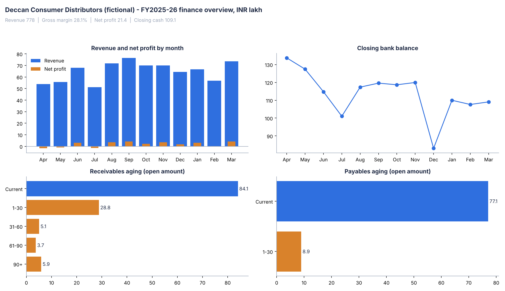

# Finance Data Warehouse (GL, AP, AR)

A star-schema finance warehouse for a fictional consumer goods distributor. It loads a year of general ledger, payables, and receivables data through a Python ETL with accounting-aware data quality checks, and publishes reporting views for a Power BI P&L, cash, and aging report.



## What it shows

- **Dimensional modeling for finance:** a general ledger fact at journal-line grain, AR and AP invoice facts at snapshot grain, and conformed date, account, cost center, customer, and vendor dimensions.
- **Accounting controls built into the pipeline:** journals must balance, the trial balance must net to zero, and the AR and AP subledgers must tie to their GL control accounts before a run is marked successful.
- **One schema for two databases:** the DDL and views are written once in SQL Server T-SQL. The ETL runs them directly on SQL Server or transpiles them with sqlglot for a zero-setup SQLite run.
- **Report-ready outputs:** P&L, cash position, and aging views, DAX measures (margins, YTD, DSO, DPO, overdue %), and a Power BI build guide.

## The business

Deccan Consumer Distributors Pvt Ltd is invented. It buys packaged goods from four suppliers and sells to 40 retailers across Bengaluru, Hyderabad, Chennai, and Coimbatore for FY2025-26 (April 2025 to March 2026). The generator posts every event as a balanced double-entry journal:

| Event | Journal |
|---|---|
| Vendor bill for stock | Dr Inventory, Dr Input GST / Cr Accounts Payable |
| Vendor payment | Dr Accounts Payable / Cr Bank |
| Sales invoice | Dr Accounts Receivable / Cr Sales, Cr Output GST; Dr COGS / Cr Inventory |
| Customer receipt (some short-paid) | Dr Bank / Cr Accounts Receivable |
| Salaries, rent, bank charges | Dr Expense / Cr Bank |
| Freight, marketing, utilities bills | Dr Expense, Dr Input GST / Cr Accounts Payable |
| Monthly GST settlement | Dr Output GST / Cr Input GST (set-off), Cr Bank (net payable) |

The year produces about 6,900 GL lines, 790 sales invoices, and 260 vendor bills, with 28% gross margin, a small net profit, seasonal festive-quarter peaks, and customers who range from prompt to slow payers.

## Schema

```
                 dim_date
                    |
dim_cost_center - fact_gl - dim_account
                    
dim_customer - fact_ar_invoice - dim_date (invoice, due)
dim_vendor   - fact_ap_invoice - dim_date (invoice, due)
```

| Table | Grain | Notes |
|---|---|---|
| fact_gl | one GL journal line | `amount` = debit minus credit |
| fact_ar_invoice | one customer invoice as of the snapshot date | received, open, days past due, aging bucket, status |
| fact_ap_invoice | one vendor bill as of the snapshot date | paid, open, days past due, aging bucket, status |
| dim_date | one day | fiscal year April to March, fiscal quarter and month |
| etl_run, dq_result | one run, one check | audit trail of every load |

Full DDL: [`sql/01_schema_sqlserver.sql`](sql/01_schema_sqlserver.sql). Views: [`sql/02_views_sqlserver.sql`](sql/02_views_sqlserver.sql).

## Data quality checks

| Stage | Check | On failure |
|---|---|---|
| Staging | Every journal balances (debits equal credits) | stop load |
| Staging | GL account codes and cost centers exist in master data | stop load |
| Staging | Posting dates fall inside the fiscal year | stop load |
| Staging | GL lines are single-sided and non-negative | stop load |
| Staging | Invoice numbers are unique; receipts and payments match an invoice | stop load |
| Staging | No invoice is settled for more than its total | stop load |
| Warehouse | Trial balance nets to zero | fail run |
| Warehouse | AR subledger open balance equals GL account 1100 | fail run |
| Warehouse | AP subledger open balance equals GL account 2000 | fail run |
| Warehouse | No negative open balances | fail run |
| Warehouse | Bank account not overdrawn | warning |

Run the generator with `--inject-issues` to seed an unbalanced journal, an unknown account, a duplicate invoice, and an overpayment. The ETL reports all four and stops before loading.

## Run it

```bash
pip install -r requirements.txt
python generator/generate_source_data.py     # writes data/source/*.csv
python etl/run_etl.py                        # builds warehouse/finance_dw.sqlite and exports/*.csv
python docs/make_preview.py                  # optional: regenerates the preview image
python -m pytest -q                          # 9 end-to-end tests
```

To load into SQL Server instead, create an empty `FinanceDW` database and set `DW_URL`:

```bash
pip install pyodbc
set DW_URL=mssql+pyodbc://@localhost/FinanceDW?driver=ODBC+Driver+18+for+SQL+Server&trusted_connection=yes&TrustServerCertificate=yes
python etl/run_etl.py
```

## Power BI

[`powerbi/BUILD_GUIDE.md`](powerbi/BUILD_GUIDE.md) covers connecting to SQL Server or the CSV exports, the relationships, and five report pages. [`powerbi/measures.dax`](powerbi/measures.dax) holds the measures: revenue, gross and net margin, YTD, cash, receivables, payables and inventory balances, DSO, DPO, overdue %, and trial balance and reconciliation controls.

## Tests

`tests/test_warehouse.py` runs the full pipeline and checks that the trial balance is zero, that assets equal liabilities plus equity plus current-year profit, that the summary and detail P&L views agree, that the cash view matches the bank account, that aging covers every open item, and that seeded defects stop the load.

## Project layout

```
generator/   source data generator (double-entry journals plus AR and AP subledgers)
sql/         SQL Server DDL and reporting views
etl/         extract, validate, transform, load, reconcile, publish
powerbi/     DAX measures and report build guide
docs/        preview image and the script that draws it
tests/       end-to-end tests
```

## Related

[erp-p2p-o2c-odoo](https://github.com/And3m/erp-p2p-o2c-odoo) runs the same purchase and sales cycles inside a real ERP (Odoo 18), documents the journal entries each step posts, and extracts them with SQL.
